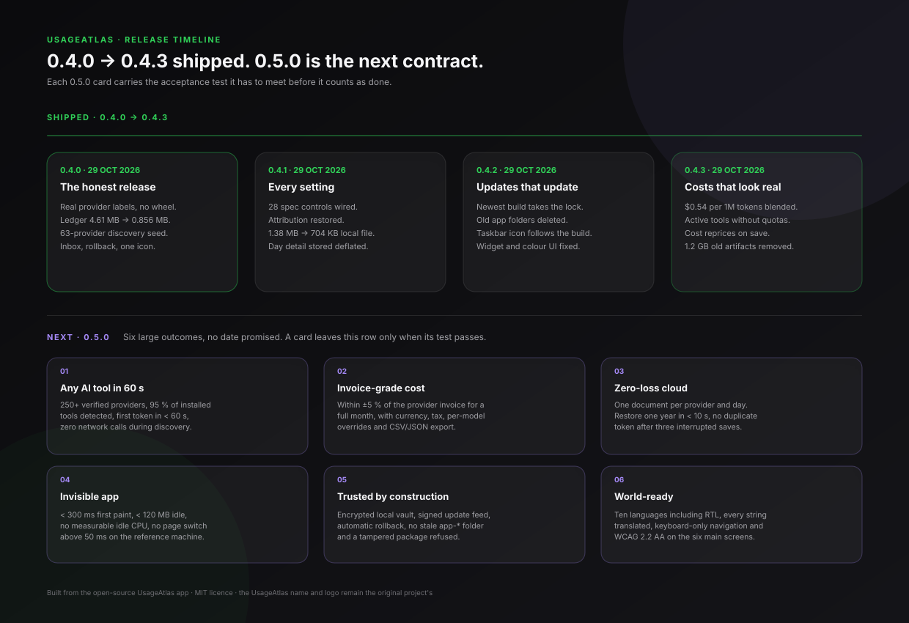

<p align="center">
  
</p>
<h1 align="center">UsageAtlas</h1>
<p align="center">
One desktop dashboard for your AI coding usage.<br>
Track local AI history, allowances and balances, and keep a copy in the cloud when you want one.
</p>
<p align="center">
<a href="https://github.com/Artleboss2/UsageAtlas-Unofficial/releases/latest"><strong>Download for Windows</strong></a>
·
<a href="https://github.com/Artleboss2/UsageAtlas-Unofficial/releases">All releases</a>
</p>

> This build starts from the open-source [UsageAtlas](https://github.com/SRX9/UsageAtlas) app and
> adds the readers, storage work and interface changes described below. It is not endorsed by the
> original project; the UsageAtlas name and logo remain theirs (see [TRADEMARKS.md](TRADEMARKS.md)).

## Timeline: 0.4.0 → 0.5.0



Earlier 0.3.x cards are in the [previous timeline](docs/timeline.svg). A 0.5.0 goal only moves to
*shipped* when its acceptance test passes in a build published from this repository.

## What 0.4.0 ships

**The truth of the usage, with no relabelling.** A cloud save now carries the provider that actually
produced the request. The old attribution wheel is gone: no source is uploaded under another
provider's name, and a source the hosted service does not model stays on this computer with a clear
notice instead of a fake label.

**A compact local ledger.** The database used to keep one observation per request, one `collection`
row per scan and one `capacity` row per quota check, plus a write-only archive of every replaced
day. On a real profile that was 2,856 rows and 4.61 MB for 259 requests. The app now:

- keeps one JSON day record per provider, merged additively (totals, hours, models, cost);
- treats the observation ledger as an **outbox**: saved request rows older than 30 days leave a
  content fingerprint behind, so a rescan never uploads anything twice;
- collapses superseded scan and quota snapshots to their newest copy;
- no longer writes the archive, and returns the freed pages with one `VACUUM`.

Measured on a copy of that profile: **4.61 MB → 0.856 MB (18.6 %), 2,856 → 285 rows**, with the day
records that feed every screen unchanged. Restoring from the cloud no longer copies the cloud ledger
back into SQLite.

**Discovery for providers nobody mapped yet.** A catalog of **250 AI providers** (agents, editors,
gateways, local runtimes) is available to the offline discovery engine. For a name it derives folder
spellings, probes SQLite and JSON stores for real token counters, and reports the files it found with
a confidence score. An unknown name comes back empty in **under two seconds**, without network access,
and a saved route is re-planned when the config directory moves.

**An inbox, not only a toast.** The last 50 alerts are kept with their arrival time and listed in
**Notifications**, even when Windows hides the toast. They survive a restart and can be cleared in one
click. The toast title now carries the UsageAtlas name, and Settings still sends a real test alert.

**An icon and a taskbar identity.** Windows resolves a taskbar button and a toast through the Start
Menu shortcut matching the app's AppUserModelID. The shortcut is written on every launch — including
development runs — with the chosen ICO and name, before the first window is created. A restart after
updating is enough for Explorer to drop the stock Electron artwork.

**An update you can undo.** Squirrel keeps every applied build under `app-<version>`. Settings now
offers a one-click **Roll back to <version>**, relaunching the newest older build with local history
untouched. The existing restart badge and the check that never reports "latest" for an older window
remain.

## What this build reads

UsageAtlas reads local activity and reuses supported tool sign-ins. Providers that need an API key or
session can be connected in **Settings → Sources**.

- **Codex** — talks to the installed, signed-in Codex CLI through its official local app-server API.
- **Claude** — reads `CLAUDE_CODE_OAUTH_TOKEN` or `.credentials.json` in the Claude config directory.
- **Cursor** — reuses the signed-in desktop session for limits plus 90 days of per-request history.
- **OpenCode** — reads the local database for per-step token, request, project and model analytics.
- **Antigravity** — reads local CLI conversation databases.
- **Pi / OMP** — reads local JSONL sessions, including cache tokens and projects.
- **Muse Code** — reads local inference and review events.
- **Freebuff** — reads the Desktop app's per-project `desktop-v2.db` (`messages.metrics_json`), with
  the CLI transcripts as a fallback. The path planner finds the database wherever Freebuff installed
  it, verifies its schema and re-plans when it moves. Opaque `m-<digest>` model ids are resolved
  offline so turns are named and priced.
- **z.ai / GLM** — reads the Coding Plan's five-hour and weekly windows from the quota API.
- **Gemini CLI, Qwen Code, Cline, Roo Code** — read the token objects their own transcripts already
  contain.

Warp, Kimi Code, Kilo Code, GitHub Copilot, Factory / Droid, Amp and Qoder supply current allowances
and balances. The seven quota readers do not provide token history, so they never enter daily totals.
See [provider setup](docs/LOCAL_PROVIDERS.md), [quota providers](docs/QUOTA_PROVIDERS.md) and the
[source survey](docs/PROVIDER_USAGE_SOURCES.md).

## Highlights

- Today view with capacity meters, reset times, plan details, credits and hourly activity
- History and insights across 7, 30 and 90 days by project, session, model and tool
- Usage alerts with a native notification and an in-app inbox
- A daily token alert that says exactly `You used 128,400 tokens on Freebuff today.`
- Appearance that stays Apple-quiet: six bundled variable fonts, a type scale, ink colour, accent
  tint, glass or solid surfaces, motion, number style, app mark and background
- Full figures by default (`1,284,930`, not `1.3M`), with short units available for charts
- Pages glide in from the side they were reached from, and the rail highlight slides between pages
- Tray presence, launch at login, system/light/dark themes
- One app instance and one taskbar identity, so a stale build never keeps the old icon
- Local tracking with no account required
- Optional free account to save history and restore it on another computer
- Sealed local history and a sandboxed renderer with an allowlisted preload API, ASAR integrity and
  Electron fuses

## Privacy

Provider data is read from local files and provider APIs. Completed-day usage and capacity snapshots
are stored in a local SQLite history database in the app data directory. Without signing in, that
history stays on this computer.

If you choose a free account, cloud saves store day totals, estimated costs, hourly activity, model
breakdowns, limits and plan information. They also retain per-request timestamps, model identifiers,
numeric token and cost measurements, and opaque project and session identifiers. Project and session
names, paths, prompts, responses, transcripts and coding-tool credentials are never included. A source
the hosted service does not model is held on this computer and named in Settings; it is not relabelled.

The optional anonymous install count is separate from cloud save. It never includes usage figures,
your account name or email, and can be switched off in Settings. Diagnostics are redacted before they
are shown or copied. See the [privacy policy](https://usageatlas.com/privacy) and
[terms of use](https://usageatlas.com/terms).

## Optional free cloud save

1. Open **Settings → Cloud save**.
2. Sign in with Google or GitHub to create or use a free UsageAtlas account.
3. Pending usage saves automatically once an hour while the app is running. Turn off **Save
   automatically** to save only when you press **Save to cloud**.
4. On another computer, sign in to the same account and choose **Restore from cloud**.

Only successfully saved history can be restored. Signing out stops future saves but does not delete
existing cloud history. A source the server refuses appears under "waiting to be saved" with its own
name, never as another provider.

## Storage

The local database is written by `apps/desktop/src/engine/history`. The day record is the source of
truth for every screen; `usage_fact` is an upload outbox and a 30-day idempotence window. The
compaction runs once per database version and is safe to interrupt: deletions are committed before
`VACUUM`, and a file locked by the background writer is compacted on the next launch.

On the measured profile the ledger occupied 3.7 MB of 4.61 MB and the write-only archive 0.75 MB.
After compaction the whole file is 0.856 MB. Tokens, costs, hourly buckets and per-model splits are
identical; only superseded scan and quota snapshots and already-uploaded request payloads are gone.
[STATISTICS_STORAGE.md](docs/STATISTICS_STORAGE.md) documents the tables and the recovery rules.

## Install

Windows builds are produced from this repository:

1. Open the [latest release](https://github.com/Artleboss2/UsageAtlas-Unofficial/releases/latest).
2. Download `UsageAtlas-<version>.Setup.exe` (per-user install, no administrator prompt) or the
   portable `UsageAtlas-win32-x64-<version>.zip`.
3. Run it. Builds are not Authenticode-signed, so SmartScreen asks for **More info → Run anyway**.

macOS and Linux are not built here. Build the fork yourself with the commands below; nothing in the
additions is Windows-specific. Every release carries `SHA256SUMS`, and Windows releases also carry
the Squirrel `RELEASES` feed and `-full.nupkg` that the in-app updater reads.

## Build from source

Requirements: Bun 1.3.14 and Node.js 22.13+.

```bash
git clone https://github.com/Artleboss2/UsageAtlas-Unofficial.git
cd UsageAtlas-Unofficial
bun ci
bun run desktop:start
```

`bun run check` runs lint, typecheck, tests and the renderer build. `bun run desktop:make` produces
installers for the current platform with Electron Forge; unsigned builds need no credentials.
`bun run desktop:make -- --platform=win32 --arch=x64 --targets squirrel zip` produces the Windows
installer, update feed and portable zip used by this repository's releases.

The repository is a Bun + Turborepo workspace: the Electron app in `apps/desktop`, shared schemas and
fixtures in `packages/contracts`, build helpers in `tooling`.

## Releases

Bump `apps/desktop/package.json`, update [CHANGELOG.md](CHANGELOG.md), then build the Windows targets
and publish the installer, `-full.nupkg`, portable zip, `RELEASES` and `SHA256SUMS` under
`desktop-v<version>`. The release workflow performs the same steps on `windows-2022`; a manual run
builds without publishing unless **publish** is enabled.

## 0.5.0 goals

Each line is an acceptance test, not a wish:

- **Appearance, deeper.** A free accent picker, per-section density, background dimming, and theme
  import/export as a small JSON file. A theme exported on one computer reproduces font, scale, ink,
  accent, surfaces and background on another, with no restart.
- **Complete translation.** Every renderer string in English, French, Spanish, Chinese and Hindi,
  including cloud, attribution-free settings and diagnostics. A missing-key test and a hard-coded
  English sweep pass.
- **Cheaper idle.** Cold start to first paint under 400 ms, under 250 MB resident after an hour idle,
  and no page switch above 50 ms on the reference machine.
- **Discovery in the app.** Type a provider name in Settings, see the probe result, its store and its
  confidence, and keep the answer when the config folder moves.
- **Compact cloud format.** One document per provider and day, merged additively, if the hosted
  service accepts it; otherwise the outbox stays the contract and is documented as such.
- **Guarded migration.** One run per account, a seven-day rollback copy, and no token lost when a
  migration is interrupted.
- **Trusted updates.** Keep the restart badge, one-click rollback and the check that never reports
  “latest” for an older window, and cover each with a test.

## Acknowledgements

Inspired by [CodexBar](https://github.com/steipete/codexbar) by Peter Steinberger. Charts are
vendored from [Dither Kit](https://tripwire.sh).

## License

Source code is available under the [MIT License](LICENSE). The UsageAtlas name and logo are not
covered by it — see [TRADEMARKS.md](TRADEMARKS.md).
